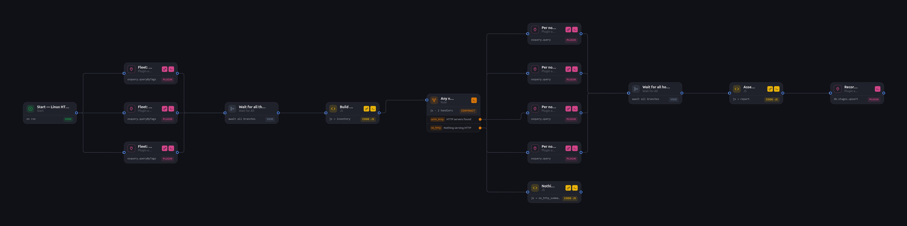

# Linux fleet — HTTP / nginx + served hostnames audit

**Ask a whole fleet "who is serving HTTP, where, and under which names?" — and get one evidence row per node.** Three fleet-wide osquery sweeps run in parallel, a JS node folds them into a per-node inventory, a rule branches on whether anything is serving at all, four more probes fan out *once per node that is*, and a final JS node assembles a report that a Venapce `db.stages.upsert` writes as one Stage row per host.

Built entirely over MCP: Claude Desktop (Opus 5) with FloMorphic's `/mcp` server connected and the [Venapce](https://inflowenger.com/venapce) plugin installed, from one prompt. Not a node was drawn by hand — and the one bug in the first version was found and fixed the same way (see [The bug, and how it was fixed](#the-bug-and-how-it-was-fixed)).

**Teaches:** fan-out / fan-in with `promissall` (three sweeps, then wait) · a JS node that **normalises plugin results** before anything downstream reads them · a `rule` node whose handlers are the branch (`with_http` / `no_http`) · **`scope` cardinality over a computed list** (`$.inventory.http_targets[*]` — four probes, once per target, `{{$this.uuid}}` pointing each at its host) · **evidence bags** — every hostname the report claims carries the sources it came from · a plugin action as the sink (Stage rows, not a chat answer).

---

## Topology

```
Start
  ├─▶ Fleet: TCP listeners + owning process      plugin  osquery.queryByTags   key: listeners
  ├─▶ Fleet: web-server processes on host        plugin  osquery.queryByTags   key: web_processes
  └─▶ Fleet: docker containers + published ports plugin  osquery.queryByTags   key: docker_web
          ↓  ↓  ↓
      Wait for all three sweeps                  promissall
          ↓
      Build per-node inventory                   js                            key: inventory
          ↓
      Any node serving HTTP?                     rule    handlers: with_http | no_http
          │
          ├─ no_http ──▶ Nothing found — note it js                            key: no_http_summary
          │
          └─ with_http ─┬─▶ Per node: nginx config files + docker labels/env   osquery.query   key: nginx_conf
                        ├─▶ Per node: nginx server_name via augeas             osquery.query   key: augeas
                        ├─▶ Per node: TLS cert CN + SANs                       osquery.query   key: tls_names
                        └─▶ Per node: OS + /etc/hosts names                    osquery.query   key: host_names
                                 (all four: scope $.inventory.http_targets[*], uuid {{$this.uuid}})
                                 ↓  ↓  ↓  ↓
                            Wait for all hostname sources                      promissall
                                 ↓
                            Assemble audit report                              js              key: report
                                 ↓
                            Record one stage row per node   plugin  db.stages.upsert   scope $.report.nodes[*]
```



---

## How it works

### 1. Three fleet-wide sweeps, in parallel

Each is a `venapce` `osquery.queryByTags` node — one SQL statement dispatched to every osctrl node carrying the tags (`default`, `linuxmint` in this export; change them to yours). They fire from Start together and a `promissall` waits for all three.

- **TCP listeners + owning process** (`listeners`) — `listening_ports ⋈ processes` on `pid`, TCP only (`protocol = 6`). Every open port on every host, with the process behind it: name, path, cmdline.
- **Web-server processes on host** (`web_processes`) — `processes` where name / path / cmdline `LIKE` any of nginx, apache, httpd, caddy, lighttpd, traefik, haproxy, envoy, gunicorn, uvicorn, tomcat. This is the sweep that catches a web server *whatever port it's on*.
- **Docker containers + published ports** (`docker_web`) — `docker_containers LEFT JOIN docker_container_ports`, so containers with no published port still appear.

Three sweeps rather than one big join because they answer different questions: *what's listening*, *what's a web server by identity*, *what's containerised*. The correlation happens in the next node, not in SQL.

### 2. Build per-node inventory (`js`, key `inventory`)

The node that does the thinking. A `rowsOf()` helper first **flattens whatever shape the plugin returned** — it walks `data.result` / `result` / `rows` / `results` / `items` recursively and stamps every row with the node uuid it came from. That one helper is why the downstream logic can be written against plain rows and not against the plugin's envelope.

Then it groups by node and classifies each listener with a **union of three signals**:

```js
likely_http: namedWeb(h) || isHttpPort(p) || viaDocker !== ''
```

- `namedWeb(h)` — process name / path / cmdline contains a known web-server name
- `isHttpPort(p)` — port is in the usual HTTP set (80, 443, 3000, 5000, 8000, 8008, 8080, 8081, 8088, 8443, 8888, 9000, 9090)
- `viaDocker` — a container published this host port

Per node it records `http_servers`, `nginx_host`, `nginx_docker`, `docker_web`, `other_web_processes`, and derives `nginx_where` ∈ `host` / `docker` / `host+docker` / `none` and `has_http`. Nodes with `has_http` become `http_targets` — each carrying `uuid`, `hostname`, `nginx_where`, and two loopback probe targets (`tls_target: 127.0.0.1:<443 or 8443>`, `http_target`) for the per-node stage.

### 3. Any node serving HTTP? (`rule`)

Two handlers — `with_http` and `no_http` — and a one-line rule: `targets.length > 0`. The handler that fires **is the edge the flow takes**. `no_http` goes to a tiny JS node that writes a summary saying nothing was found (and how many Linux nodes answered). `with_http` fans out into the four probes.

### 4. Four probes, once per target (`scope: $.inventory.http_targets[*]`)

All four are `osquery.query` — a single-host query — and all four carry `"uuid": "{{$this.uuid}}"`. The scope is the list the inventory node *computed*, so **the fan-out width is decided at runtime by the data**, not by the drawing. Four nodes on the canvas; on a fleet with seven HTTP hosts that's twenty-eight queries.

| Node | key | What it reads |
| --- | --- | --- |
| nginx config files + docker labels/env | `nginx_conf` | `file` under `/etc/nginx/`, `/etc/apache2/sites-enabled/`, `/etc/httpd/conf.d/`, `/etc/caddy/` ∪ `docker_container_labels` ∪ `docker_container_envs` |
| nginx server_name via augeas | `augeas` | the `augeas` table over `/etc/nginx/nginx.conf` — parsed directives, so `server_name` values come out as rows |
| TLS cert CN + SANs | `tls_names` | `curl_certificate` against `{{$this.tls_target}}` — the cert the host actually presents on its TLS port |
| OS + /etc/hosts names | `host_names` | `os_version` ∪ `etc_hosts` |

A second `promissall` waits for all of them.

### 5. Assemble audit report (`js`, key `report`)

For each target, builds a **hostname bag**: `bag[name] = [sources…]`. `bagAdd()` splits on whitespace/commas, strips nginx punctuation, drops `_`, `localhost`, anything with `/` or `:`, and anything short with no dot — then records *where each name was seen*:

- `nginx_server_name` — augeas rows whose label contains `server_name`
- `docker_env` — env keys containing `virtual_host`, `letsencrypt_host`, `server_name`, `domain`, `hostname`
- `traefik_label` — labels containing `Host(...)` (each `Host(` segment is parsed out)
- `docker_label` — labels with `virtual.host` / `domain`
- `tls_common_name`, `tls_san` — from the cert probe
- `etc_hosts` — from `/etc/hosts`
- `node_hostname` — the host's own name

So a name in the report never stands alone: `{ name: "app.example.com", sources: ["nginx_server_name", "tls_san"] }`. That's the evidence travelling with the claim. Each node record also carries its OS, nginx location, listeners, containers, config files, a one-line `summary`, and a `data_json` string prepared for the sink.

### 6. Record one stage row per node (`plugin`, `db.stages.upsert`, scope `$.report.nodes[*]`)

The sink. Once per report node it writes a Venapce **Stage** row: title `HTTP/nginx audit — {{$this.hostname}}`, `disposition: {{$this.nginx_where}}`, tags `linux / http-audit / nginx`, summary and the full `data_json`. Nothing is answered in chat; the output is rows you can chart, filter and revisit in Venapce.

---

## The bug, and how it was fixed

The first version this flow ran with **defined "HTTP process" too narrowly**: a listener only counted if it matched on process name *and* port. Web servers running directly on the host — on a port that wasn't in the list, or under a name that wasn't — dropped silently. The run went green; the report had a hole.

The fix is what you see in the export now, in two places:

1. `likely_http` in **Build per-node inventory** is an **OR** of three signals (name, port, docker-published), not a conjunction.
2. The dedicated **web-server processes on host** sweep exists at all — it finds a web server by identity regardless of port, and `has_http` unions its results in (`other_web_process_count > 0`).

What's worth noticing is *how* it was fixed. The problem was described in chat; the assistant read the finished process and its Context over MCP, saw what each node had actually emitted, changed the filter and the sweep, launched a new run, waited for it to finish, and read the Context again to confirm the host servers were now present. Build → run → observe → diagnose → fix → verify, without opening the canvas — because a process's Context is readable evidence, not a screenshot. How to connect an agent: [Drive FloMorphic from your agent](https://inflowenger.com/blog/drive-flomorphic-from-your-agent).

---

## Run it

1. **Have Venapce's fleet side available.** The plugin nodes need the **`venapce`** plugin installed on your FloMorphic and an osctrl it can reach (your own, or a space at [osctrl.inflowenger.com](https://osctrl.inflowenger.com)) with Linux nodes enrolled. See [Your fleet is a live database](https://inflowenger.com/blog/your-fleet-is-a-live-database) for the setup.
2. Import `linux-fleet-http-nginx-served-hostnames-audit.flow.json` into the canvas. The `plugins` block in the export names the three actions it needs (`osquery.queryByTags`, `osquery.query`, `db.stages.upsert`); the importer will tell you if any are missing.
3. **Change the tags.** The three sweep nodes carry `"tags": ["default", "linuxmint"]` — the tags of the fleet this was exported from. Set them to the osctrl tags that select *your* Linux nodes. `env` is `default` on every query; change it if your osctrl uses another environment.
4. Select the Venapce plugin's **settings profile** on the plugin nodes if your install requires one — the export carries no `settingsId` and no credentials.
5. Hit **Run** with an empty Context. The three sweeps trace first, `inventory` lands, the rule fires, and the per-node probes fan out to as many hosts as `http_targets` holds. Open Venapce afterwards: one new Stage row per host that served HTTP, tagged `http-audit`.

---

## Notes on this export

- `curl_certificate` probes `127.0.0.1:443` (or `8443` if that's what's listening). A host that serves TLS only through a Docker-published port on another number will return no cert rows — the report simply has fewer sources for that host, not a failure.
- The `augeas` probe reads only `/etc/nginx/nginx.conf`. Sites included from `sites-enabled/` or `conf.d/` show up as **config files** (from the `file` table) but their `server_name` directives aren't parsed. Extending the `augeas` `WHERE` to those paths is the obvious next edit.
- The HTTP port list and the web-server name list live at the top of **Build per-node inventory**. If your fleet runs something unusual (a Node app on 4000, say), add it there — that's the whole definition of "looks like HTTP" in this flow.
- Node refs, titles, keys and positions are kept as exported so the canvas matches the screenshot above.
